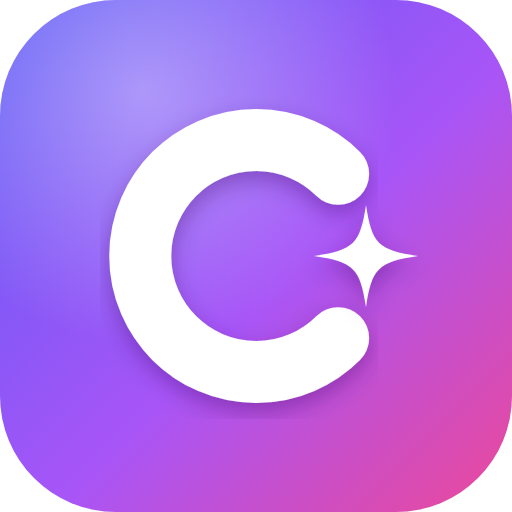
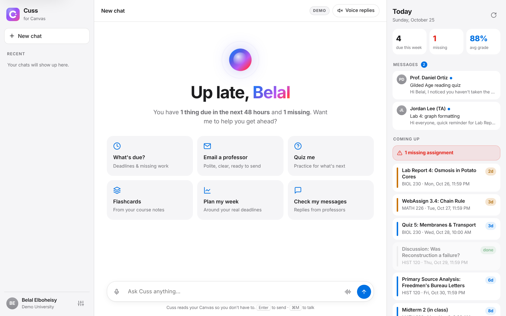

<h1 align="center">Cuss for Canvas</h1>

<b>Your semester. Handled.</b> 
An AI assistant for Canvas, powered by Claude, for first-gen, working, commuting and transfer students at SF State.

  <a href="https://cuss.onrender.com"><b>Try the live demo →</b></a> &nbsp;·&nbsp;
  <a href="https://cuss.onrender.com/impact">Impact dashboard</a> &nbsp;·&nbsp;
  <a href="DEVPOST.md">Devpost write-up</a>

  Built by Belal Elboheisy at <b>Cal Hacks 13.0</b> (solo) · Anthropic <i>Claude for Public Benefit</i> track

> **No account needed:** open the demo, click **Try the student demo** or **Professor demo**, and sign in to "Demo University", a practice Canvas with sample classes, deadlines, professors and course files. The AI is real.

## Why
Canvas has everything a student needs, but it's a filing cabinet, not an assistant. Deadlines hide in modules, announcements move quizzes, and a professor's message offering a second chance is easy to miss. Students with jobs, long commutes or no one at home who's been through college have the least time to dig through five differently organized courses. Cuss reads Canvas for them and acts on it.

## Tech
| Part | What it uses |
|---|---|
| AI agent | Claude (Anthropic API) with tool use: it decides which Canvas data to fetch, reads PDFs natively, and every step streams to the screen |
| Canvas | Canvas REST API and official Canvas OAuth2 sign-in through the school's SSO |
| Server | Node.js + Express, per-user storage, encrypted tokens, background reminders |
| App | Vanilla JavaScript, HTML and CSS (no build step), installable PWA, Web Speech API for voice, Capacitor project for iOS and Android |
| Quality | `node:test` suite and GitHub Actions; hosted on Render (`render.yaml`) |
| Built with | Claude Code, during the hackathon |

## Roadmap
- SF State pilot once the Canvas developer key is approved
- Move the frontend to React, and storage to a Postgres database
- App Store and Google Play release with push notifications
- Google Calendar and school email integration
- Any Canvas school can turn on Cuss with one approval

---

## What it does
Students click **"Log in with SFSU Canvas"**, sign in on the usual school login page, and Cuss:

- **Reminds them about due dates.** It alerts them 3 days, 1 day and 3 hours before anything unsubmitted is due (adjustable) and when there's a new announcement. A one-click calendar export covers Google, Apple and Outlook.
- **Reads and answers your Canvas Inbox.** "Any messages from my professors?" gets a summary, and Cuss drafts replies you send with one click. You also get an alert when a professor writes back.
- **Writes emails to professors.** It finds the right instructor or TA, writes a polite message, and sends it through Canvas Inbox when the student presses **Send** (or says *"send it"*).
- **Helps them study.** It reads their actual course pages, assignments, syllabus and **course files: PDFs (including diagrams and tables), PowerPoint slides with speaker notes, Word documents, images and text files**, explains topics, and makes **flashcards** and **practice quizzes**.
- **Remembers them.** Saved chats appear in the sidebar, and long-term notes about the student (major, study style…) carry across chats.
- **Can work independently.** In *Independent mode*, Cuss checks Canvas every morning by itself and writes a daily briefing and study plan.
- **Talks.** Students can tap the 🎤 mic and speak, and turn on **Voice replies** for hands-free conversation.

**Try it without a school account:** click **Try the student demo** (or **Professor demo**) on the login page. You sign in on a practice login page for "Demo University" and get a sample student with real-looking classes, deadlines, professors and course notes. The AI is real, so chatting, quizzes, flashcards and emails all work, but demo emails go nowhere. This is handy for showing Cuss to schools.

**Cuss for Professors.** When an instructor signs in, Cuss switches to professor mode automatically (Canvas tells it who teaches what): who's falling behind (missing work, low scores), what needs grading, summaries of and reply drafts for student messages, kind check-in messages to students with missing work, course announcements the professor reviews and posts, and practice quizzes built from their own lecture files. Student privacy comes first: grades are only ever shown to the professor, and nothing reaches students until the professor approves it. Try it with **Professor demo** on the login page.

Each student's chats, notes and settings are private to them. Students can log out, or delete their data and disconnect at any time (Settings → *Delete my data*).

---

## Setting it up (for the person running the app)

Students don't install anything. One person runs the app, and everyone else just logs in.

### 1. Install and configure
1. Install Node.js 20.12 or newer from <https://nodejs.org>.
2. In the app folder, copy `.env.example` to a new file named `.env` and fill in:
   - `CANVAS_URL`: `https://sfsu.instructure.com`
   - `ANTHROPIC_API_KEY`: from <https://console.anthropic.com/settings/keys> (pay-as-you-go; all students' chats use this key, and `DAILY_MESSAGE_LIMIT` caps each student's daily use)
3. In Terminal, from the app folder: `npm install`, then `npm start`. Open <http://localhost:3000>.

### 2. Turn on "Log in with Canvas" (needs your school's approval)
Canvas only lets an app use the school's login page once the school's Canvas admins register it and issue a **Developer Key**. Students can't create one themselves.

1. Send the request in **`ADMIN-REQUEST.md`** to your school's Canvas support (fill in the brackets).
2. When they reply with a **Client ID** and **Client Secret**, put them in `.env` as `CANVAS_CLIENT_ID` and `CANVAS_CLIENT_SECRET`. If they set up scopes, also paste those into `CANVAS_SCOPES`.
3. Restart the app. The terminal says **"✓ Canvas SSO login is on"**, and the login button works.

Until then, the login page shows **"Use a Canvas access token instead"**. That works at schools that allow personal tokens, or with a token an SFSU admin generates for you.

### Quick public demo (for hackathons and judges)
This repo includes a `render.yaml`, so you can host the demo free on [Render](https://render.com):
1. Sign up at render.com with your GitHub account.
2. Click **New + → Blueprint**, pick this repo, and click **Apply**.
3. When asked, paste your `ANTHROPIC_API_KEY`. Everything else is preset: demo mode, a fast AI setting, and daily message caps (40 per visitor, 400 total) to protect your bill.
4. Your link appears at the top (like `https://cuss.onrender.com`). Open **`/share`** on it for a big QR code to show on screen.

The free plan sleeps after 15 minutes without visitors, so the first visit afterwards takes about a minute. Open the link a few minutes before judging (or upgrade to the $7 plan for the day).

### 3. Share it with other students (hosting)
Running it on your laptop lets you use it yourself. For other students, it needs to run on a server with a public `https://` address, for example Render, Railway or Fly.io:
- Set the same values as your `.env` in the host's "environment variables" settings, plus `HOST=0.0.0.0` and `PUBLIC_URL=https://your-app-address`.
- Give the app a **persistent disk** for the `data/` folder (or set `DATA_DIR` to one). That's where logins, chats and memory are saved.
- Ask the Canvas admins to add `https://your-app-address/auth/callback` as a redirect URI on the Developer Key.
- Expect your school to ask about student-data privacy (FERPA). `ADMIN-REQUEST.md` explains how data is handled.

#### Fast hackathon deployment on Render

1. Create a new **Web Service** from this repository.
2. Render can use the included `render.yaml`; otherwise use `npm ci` as the build command and `npm start` as the start command.
3. Set `PUBLIC_URL` to the exact Render URL, `ANTHROPIC_API_KEY` to the server's key, and `DATA_DIR` to a persistent disk path if you need logins to survive deploys.
4. Open `https://your-app-address/share` to show the judge QR code. It points to the login page, where judges can choose **Try the demo** without a Canvas account.

The included `manifest.webmanifest`, `sw.js`, and `logo.svg` make the judge experience installable as a PWA on supported browsers. A native iOS/Android wrapper can use the same hosted URL after the hackathon; store submission still requires platform accounts, signing, privacy disclosures, and review.

---

## Using it (for students)
1. Open the app and click **Log in with SFSU Canvas**.
2. Sign in as usual, and click **Authorize** when Canvas asks.
3. Click **Enable reminders** in the sidebar.

Things to try:
- "What's due this week? Anything missing?"
- "Email my biology professor that I'll miss Thursday's lab and ask how to make it up."
- "Quiz me on chapter 4 from my psych class."
- "Make flashcards from this week's module in Chem."
- "Remind me tomorrow at 6pm to start my essay."
- "Remember that I'm a nursing major and I like practice questions."

> 🎤 Voice input works best in **Chrome or Edge**. Allow microphone access when asked.

### Settings
| Setting | What it does |
|---|---|
| Remind me before due dates | Hours before a deadline to get a reminder (default `72, 24, 3`). |
| Independent mode | Daily check-in at your chosen time, saved as a ☀️ *Daily briefing* chat. **Run a briefing now** tries it out right away. |
| Send emails without asking me | **Off (recommended):** you review every email and press Send. **On:** Cuss sends as soon as you ask. Independent check-ins never send emails. |
| What Cuss remembers | View, add or delete Cuss's notes about you. |
| Delete my data & disconnect | Erases your chats, notes and settings and revokes Cuss's Canvas access. |

## Troubleshooting
- **The login page says Canvas login isn't switched on:** the Developer Key isn't in `.env` yet (see step 2).
- **"Canvas didn't allow that":** your professor may have restricted that page or file. If it happens everywhere, log out and back in.
- **No reminders:** click *Enable reminders*, and keep the app running.

## Security & quality
- Canvas tokens are **encrypted at rest** (AES-256-GCM; key from `TOKEN_ENCRYPTION_KEY`, generated automatically on Render).
- Each student's data is isolated; cross-site requests are blocked; per-student and overall daily AI caps.
- **Log out of all devices** and **Delete my data & disconnect** in Settings.
- Accessibility: labeled controls, visible keyboard focus, a skip link, screen-reader announcements for new messages, and reduced-motion support.
- **Tests:** `npm test` runs 19 automated tests (OAuth sign-in, data isolation, email/reply drafts, PDF/PowerPoint/Word reading, encryption, caps, sessions). They also run on every push via GitHub Actions.

## How it works
- `server.js`: web server, login routes, API.
- `lib/auth.js`: Canvas OAuth2 sign-in (school SSO), automatic token refresh, sessions.
- `lib/store.js`: per-student storage under `data/users/<canvas id>/`.
- `lib/canvas.js`: Canvas REST API (planner, courses, modules, pages, files, inbox).
- `lib/agent.js`: the AI assistant (Claude) and its tools.
- `lib/chats.js`: saved chats, email drafts, long-term memory.
- `lib/reminders.js`: background reminders, announcements, independent-mode briefings, calendar feed.
- `public/`: the web app (`login.html` landing page, chat with live AI steps, Today panel, voice mode, flashcards, quizzes).

Built at Cal Hacks 13.0. Install it on a phone by opening the link and tapping **Add to Home Screen**. For App Store and Google Play builds, see **`mobile/STORE-GUIDE.md`**.

Presenting Cuss? See **`DEMO-SCRIPT.md`** for a 3-minute walkthrough and a pre-demo checklist.
